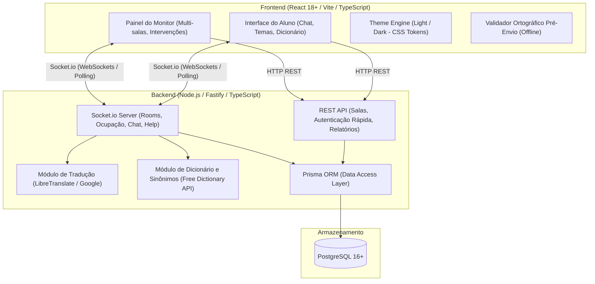
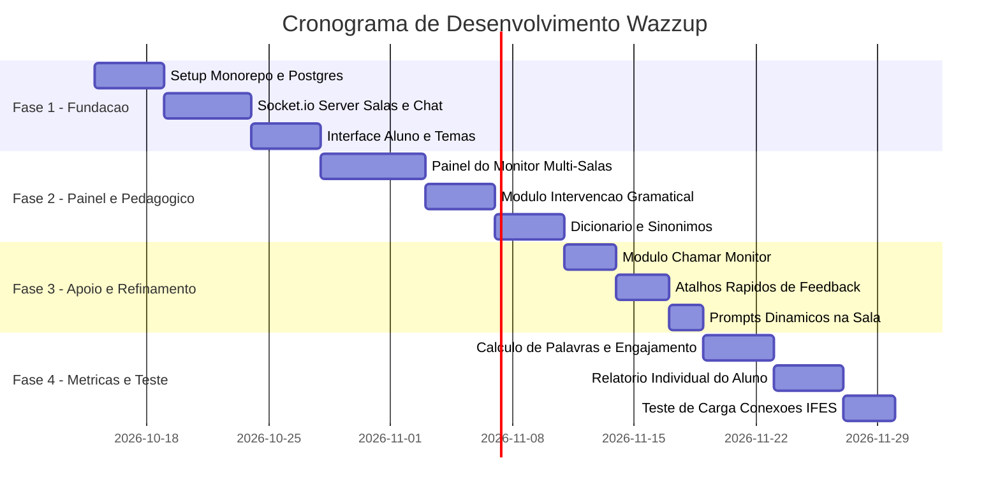

# Plano de Implementação Técnico — Wazzup (EnglishTalks)

**Stack Definida:** Full-Stack TypeScript (Node.js + Socket.io + React + PostgreSQL + Prisma ORM)  
**Ambiente Alvo:** Laboratórios de Informática do IFES e Acesso Web Geral  
**Capacidade Operacional:** 30+ participantes simultâneos por sessão (com capacidade para centenas em arquitetura escalável)

---

## 1. Visão Geral da Arquitetura

O **Wazzup** é estruturado como um monorepo enxuto em **TypeScript ponta a ponta**, garantindo compartilhamento imediato de tipagens, DTOs e eventos de WebSocket entre o servidor e o cliente.



---

## 2. Estrutura de Diretórios do Projeto

```text
EnglishTalks/
├── package.json
├── tsconfig.base.json
├── shared/                         # Tipos, contratos e DTOs compartilhados
│   ├── types/
│   │   ├── events.ts              # Nomes e payloads de eventos Socket.io
│   │   ├── chat.ts                # DTOs de mensagem e correção
│   │   └── room.ts                # DTOs de sala e ocupação
│   └── index.ts
├── server/                         # Backend Node.js
│   ├── prisma/
│   │   └── schema.prisma          # Modelagem de dados do PostgreSQL
│   ├── src/
│   │   ├── config/                # Variáveis de ambiente e banco
│   │   ├── controllers/           # Handlers REST
│   │   ├── sockets/               # Handlers de eventos Socket.io por namespace
│   │   │   ├── chatHandler.ts
│   │   │   ├── roomHandler.ts
│   │   │   └── monitorHandler.ts
│   │   ├── services/
│   │   │   ├── translationService.ts
│   │   │   ├── dictionaryService.ts
│   │   │   └── metricsService.ts
│   │   └── server.ts
│   └── tsconfig.json
├── client/                         # Frontend React + Vite
│   ├── src/
│   │   ├── assets/
│   │   ├── components/            # Componentes reutilizáveis
│   │   │   ├── chat/              # Bolhas de chat, badges de correção
│   │   │   ├── monitor/           # Grid multi-salas, fila de chamados
│   │   │   ├── pedagogy/          # Modal de dicionário, sugestões
│   │   │   └── ui/                # Botão de tema, inputs minimalistas
│   │   ├── contexts/              # SocketContext, ThemeContext
│   │   ├── hooks/                 # useChat, useDictionary, useTheme
│   │   ├── pages/
│   │   │   ├── LobbyPage.tsx      # Entrada (nickname + código da sala)
│   │   │   ├── RoomPage.tsx       # Chat do aluno
│   │   │   └── MonitorPage.tsx    # Dashboard do monitor
│   │   ├── styles/
│   │   │   ├── tokens.css         # Variáveis de cores Claro/Escuro
│   │   │   └── global.css
│   │   ├── App.tsx
│   │   └── main.tsx
│   ├── index.html
│   ├── vite.config.ts
│   └── tsconfig.json
└── IMPLEMENTATION_PLAN.md
```

---

## 3. Modelagem de Dados — PostgreSQL com Prisma ORM

Arquivo: `server/prisma/schema.prisma`

```prisma
datasource db {
  provider = "postgresql"
  url      = env("DATABASE_URL")
}

generator client {
  provider = "prisma-client-js"
}

enum UserRole {
  STUDENT
  MONITOR
  ADMIN
}

enum HelpStatus {
  PENDING
  IN_PROGRESS
  RESOLVED
  CANCELLED
}

model User {
  id              String         @id @default(uuid())
  nickname        String         @db.VarChar(60)
  institutionalId String?        @map("institutional_id") @db.VarChar(50)
  role            UserRole       @default(STUDENT)
  createdAt       DateTime       @default(now()) @map("created_at")
  lastActive      DateTime       @default(now()) @map("last_active")

  messages        ChatMessage[]
  corrections     GrammarCorrection[] @relation("MonitorCorrections")
  helpRequests    HelpRequest[]       @relation("StudentHelpRequests")
  attendedHelps   HelpRequest[]       @relation("MonitorAttendedRequests")
  participations  RoomParticipant[]
  metrics         StudentMetric[]

  @@map("users")
}

model Room {
  id           String            @id @default(uuid())
  code         String            @unique @db.VarChar(10)
  title        String            @db.VarChar(100)
  topicPrompt  String            @map("topic_prompt") @db.Text
  maxCapacity  Int               @default(4) @map("max_capacity")
  isActive     Boolean           @default(true) @map("is_active")
  createdAt    DateTime          @default(now()) @map("created_at")

  participants RoomParticipant[]
  messages     ChatMessage[]
  helpRequests HelpRequest[]

  @@map("rooms")
}

model RoomParticipant {
  id        String    @id @default(uuid())
  roomId    String    @map("room_id")
  userId    String    @map("user_id")
  joinedAt  DateTime  @default(now()) @map("joined_at")
  leftAt    DateTime? @map("left_at")
  isCurrent Boolean   @default(true) @map("is_current")

  room      Room      @relation(fields: [roomId], references: [id], onDelete: Cascade)
  user      User      @relation(fields: [userId], references: [id], onDelete: Cascade)

  @@index([roomId, isCurrent])
  @@map("room_participants")
}

model ChatMessage {
  id               String              @id @default(uuid())
  roomId           String              @map("room_id")
  senderId         String              @map("sender_id")
  originalText     String              @map("original_text") @db.Text
  wordCount        Int                 @default(0) @map("word_count")
  hasSpellingIssue Boolean             @default(false) @map("has_spelling_issue")
  createdAt        DateTime            @default(now()) @map("created_at")

  room             Room                @relation(fields: [roomId], references: [id], onDelete: Cascade)
  sender           User                @relation(fields: [senderId], references: [id])
  corrections      GrammarCorrection[]

  @@index([roomId, createdAt])
  @@map("chat_messages")
}

model GrammarCorrection {
  id              String      @id @default(uuid())
  messageId       String      @map("message_id")
  monitorId       String      @map("monitor_id")
  correctedText   String      @map("corrected_text") @db.Text
  explanationRule String      @map("explanation_rule") @db.Text
  shortcutTag     String?     @map("shortcut_tag") @db.VarChar(50)
  createdAt       DateTime    @default(now()) @map("created_at")

  message         ChatMessage @relation(fields: [messageId], references: [id], onDelete: Cascade)
  monitor         User        @relation("MonitorCorrections", fields: [monitorId], references: [id])

  @@map("grammar_corrections")
}

model HelpRequest {
  id          String     @id @default(uuid())
  roomId      String     @map("room_id")
  requestedBy String     @map("requested_by")
  attendedBy  String?    @map("attended_by")
  status      HelpStatus @default(PENDING)
  createdAt   DateTime   @default(now()) @map("created_at")
  resolvedAt  DateTime?  @map("resolved_at")

  room        Room       @relation(fields: [roomId], references: [id], onDelete: Cascade)
  student     User       @relation("StudentHelpRequests", fields: [requestedBy], references: [id])
  monitor     User?      @relation("MonitorAttendedRequests", fields: [attendedBy], references: [id])

  @@index([status])
  @@map("help_requests")
}

model MonitorShortcut {
  id               String @id @default(uuid())
  category         String @db.VarChar(50)
  label            String @db.VarChar(80)
  templateFeedback String @map("template_feedback") @db.Text
  explanationRule  String @map("explanation_rule") @db.Text

  @@map("monitor_shortcuts")
}

model StudentMetric {
  id                  String   @id @default(uuid())
  userId              String   @map("user_id")
  sessionDate         DateTime @default(now()) @map("session_date") @db.Date
  totalMessages       Int      @default(0) @map("total_messages")
  totalWords          Int      @default(0) @map("total_words")
  correctionsReceived Int      @default(0) @map("corrections_received")
  activeMinutes       Int      @default(0) @map("active_minutes")
  commonErrors        Json     @default("[]") @map("common_errors")

  user                User     @relation(fields: [userId], references: [id], onDelete: Cascade)

  @@unique([userId, sessionDate])
  @@map("student_metrics")
}
```

---

## 4. Comunicação em Tempo Real (Socket.io)

### 4.1 Contratos de Eventos Compartilhados (`shared/types/events.ts`)

```typescript
export interface ServerToClientEvents {
  // Salas & Ocupação
  'room:occupancy_updated': (data: { roomCode: string; count: number; max: number }) => void;
  'room:topic_changed': (newTopic: string) => void;
  
  // Mensagens
  'chat:message_received': (message: ChatMessageDto) => void;
  'chat:correction_applied': (correction: CorrectionDto) => void;
  
  // Suporte e Ajuda
  'help:status_changed': (data: { requestId: string; status: string; monitorName?: string }) => void;
  'monitor:new_help_alert': (alert: HelpAlertDto) => void;
}

export interface ClientToServerEvents {
  // Ações do Aluno
  'room:join': (payload: { roomCode: string; nickname: string }, callback: (response: JoinRoomResult) => void) => void;
  'room:leave': () => void;
  'chat:send': (payload: { text: string }) => void;
  'help:request': () => void;

  // Ações do Monitor
  'monitor:subscribe_dashboard': () => void;
  'monitor:correct_message': (payload: { messageId: string; correctedText: string; rule: string; tag?: string }) => void;
  'monitor:attend_help': (payload: { requestId: string }) => void;
  'monitor:update_topic': (payload: { roomId: string; newTopic: string }) => void;
}
```

### 4.2 Desempenho e Resiliência para 30+ Usuários
* **Modos de Transporte:** O cliente Socket.io é configurado com `transports: ['websocket', 'polling']`. Se o laboratório do IFES bloquear WebSockets puros em algum proxy de rede, o Socket.io fará a transição automática para HTTP long-polling sem desconectar o aluno.
* **Memória em Repouso:** 30 a 50 sockets abertos consomem ~40MB de RAM no processo Node.js, com latência típica de trânsito de mensagens < 15ms.

---

## 5. Módulos Pedagógicos e Recursos de Apoio

### 5.1 Dicionário de Contexto & Sinônimos
* **API Externa Utilizada:** [Free Dictionary API](https://dictionaryapi.dev/) (`https://api.dictionaryapi.dev/api/v2/entries/en/<palavra>`).
* **Cache em Memória (LRU):** Para não repetir requisições desnecessárias, palavras consultadas com frequência ficam em cache de 2 horas no servidor.
* **Comportamento na UI:** 
  * Selecionar qualquer palavra na mensagem abre um popover flutuante:
    * **Definição curta em inglês**.
    * **3 sinônimos diretos** para incentivar vocabulário variado sem recorrer ao português.
    * Botão secundário: "Traduzir para o Português".

### 5.2 Módulo de Tradução Integrado
* **Fallback Híbrido:**
  1. Consulta serviço leve do backend via wrapper do Google Translate (`@iamtraction/google-translate` ou instância LibreTranslate).
  2. Retorna a frase completa traduzida sob demanda em uma aba recolhível da barra de digitação.

### 5.3 Corretor Ortográfico Automático
* **Validador no Envio:** Uso de biblioteca léxica leve (`nspell` com dicionário en-US em memória no backend) ou verificação nativa do navegador (`spellcheck="true"`). Se o aluno comete erro evidente de grafia (ex.: "thier" em vez de "their"), o sistema alerta antes do envio para que ele corrija ativamente.

### 5.4 Atalhos Rápidos do Monitor (1-Click Feedback)
* O monitor tem acesso a botões com regras frequentes que geram feedback com 1 clique:
  * `[+ 3rd Person 's']` $\to$ "Remember to add '-s' to verbs in the 3rd person singular (he/she/it)."
  * `[Past Tense -ed]` $\to$ "Regular verbs in the past tense usually end in '-ed'."
  * `[Adjective Order]` $\to$ "Adjectives go before the noun (e.g., 'a red car', not 'a car red')."

---

## 6. Experiência de Interface (UI/UX) para Laboratórios do IFES

### 6.1 Tokens de Design & Paleta Oficial (Identidade Visual IFES)

O projeto adota **estritamente a paleta institucional do Instituto Federal**:

* **Ação e Identidade:**
  * **Primary (Verde IF):** `#009639` (Botões de envio, cabeçalho, balão próprio de chat, identidade ativa)
  * **Primary Dark (Hover/Contraste):** `#007A2E` (Estados de hover em botões, bordas com foco)
  * **Accent / Alerta (Vermelho IF):** `#C8102E` (Botão e alertas de "Chamar Monitor", tags de urgência, ações destrutivas)
* **Neutros e Superfícies (Modo Claro):**
  * **Background Primário:** `#FFFFFF` (Fundo de tela principal, cartões e painéis de mensagens)
  * **Background Secundário:** `#F4F6F8` (Fundo da sala, áreas de digitação, balão do colega)
  * **Bordas e Divisores:** `#E2E8F0` (Bordas de cards, divisórias e campos de input)
  * **Texto Principal:** `#1E293B` (Títulos, texto de mensagens e alto contraste)
  * **Texto Secundário / Muted:** `#64748B` (Horários, legendas e textos de suporte)

```css
/* client/src/styles/tokens.css */
:root {
  /* Marca e Ação (Verde IF e Vermelho IF) */
  --color-primary: #009639;
  --color-primary-hover: #007A2E;
  --color-accent-alert: #C8102E;

  /* Superfícies e Neutros (Modo Claro) */
  --bg-primary: #FFFFFF;
  --bg-secondary: #F4F6F8;
  --border-color: #E2E8F0;
  --text-primary: #1E293B;
  --text-muted: #64748B;

  /* Aplicações de Chat & Componentes */
  --chat-bubble-self-bg: var(--color-primary);
  --chat-bubble-self-text: #FFFFFF;
  --chat-bubble-other-bg: var(--bg-secondary);
  --chat-bubble-other-text: var(--text-primary);
  --correction-badge-border: var(--color-primary);
  --correction-badge-bg: rgba(0, 150, 57, 0.08);
}

[data-theme="dark"] {
  /* Marca permanece consistente */
  --color-primary: #009639;
  --color-primary-hover: #007A2E;
  --color-accent-alert: #C8102E;

  /* Superfícies e Neutros (Modo Escuro) */
  --bg-primary: #0F172A;
  --bg-secondary: #1E293B;
  --border-color: #334155;
  --text-primary: #F8FAFC;
  --text-muted: #94A3B8;

  /* Aplicações de Chat & Componentes no Escuro */
  --chat-bubble-self-bg: var(--color-primary);
  --chat-bubble-self-text: #FFFFFF;
  --chat-bubble-other-bg: var(--bg-secondary);
  --chat-bubble-other-text: var(--text-primary);
  --correction-badge-border: var(--color-primary);
  --correction-badge-bg: rgba(0, 150, 57, 0.2);
}
```

### 6.2 Otimização de Tela e Monitores 1366x768
* Altura fixa em `100dvh` (Dynamic Viewport Height) para evitar barras de rolagem duplas.
* Input de texto fixo com atalhos de teclado (`Enter` envia, `Shift + Enter` pula linha, `Ctrl + K` abre o dicionário).
* Painel minimalista que prioriza o foco na conversa entre a dupla.

---

## 7. Fases de Implementação



### Detalhamento das Entregas:

* **Fase 1: Fundação & Tempo Real Base**
  * Inicialização do projeto (Vite no `client`, Fastify/Express no `server`, `shared`).
  * Banco PostgreSQL configurado com Prisma (`User`, `Room`, `ChatMessage`).
  * Fluxo de entrada por `nickname` + `roomCode`.
  * Chat em tempo real funcionando com contagem de ocupação e alternância Claro/Escuro.

* **Fase 2: Painel de Monitoria & Recursos Pedagógicos**
  * Tela dos monitores com visualização em grade de todas as salas ativas.
  * Recurso do monitor: clicar na mensagem do aluno e submeter correção + explicação da regra.
  * Sinalização sutil na mensagem para o aluno com balão explicativo ao clicar.
  * Ferramenta de consulta a sinônimos e definições em inglês.

* **Fase 3: Módulos de Suporte & Interação**
  * Botão "Chamar Monitor" com alerta em tempo real no dashboard.
  * Biblioteca de atalhos rápidos com regras gramaticais pré-configuradas.
  * Caixa de prompts disparadores de conversa no topo do chat.

* **Fase 4: Métricas de Aprendizado & Teste em Laboratório**
  * Agregação de volume de palavras em inglês e tempo de sessão.
  * Relatório de progresso para o aluno com os pontos gramaticais mais corrigidos.
  * Validação de conexão e latência simulando 30 a 50 alunos simultâneos.

---

## 8. Infraestrutura e Containerização (Docker & Docker Compose)

A aplicação é 100% orquestrada em containers Docker para assegurar reprodutibilidade tanto nos laboratórios do IFES quanto em ambientes de produção:

1. **`wazzup_postgres` (PostgreSQL 16 Alpine):**
   * Persistência de dados através do volume gerenciado `postgres_data`.
   * Verificação contínua de integridade via healthcheck (`pg_isready`).

2. **`wazzup_server` (Node.js 20 Alpine):**
   * Multi-stage build otimizado com compilação de TypeScript e Prisma Client.
   * Conecta ao PostgreSQL apenas quando o healthcheck reporta estado saudável.
   * Expõe a porta 4000 para REST e Socket.io.

3. **`wazzup_client` (Nginx Alpine):**
   * Multi-stage build que compila o bundle do React (Vite) e serve arquivos estáticos com compressão Gzip.
   * Atua como Reverse Proxy para `/api/` e `/socket.io/` com suporte a upgrade de WebSockets, eliminando problemas de CORS e resolução de domínios.

